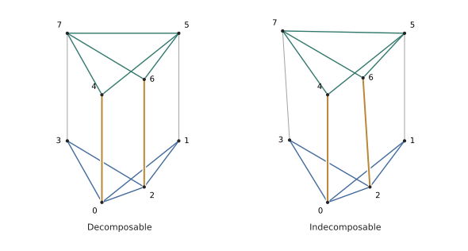

# The sharp vertex bound for conditional decomposability

## The result and its exact scope

The main claim is Theorem 1 of the paper: in every dimension $d\geq3$, the least possible number of vertices of a conditionally Minkowski decomposable $d$-polytope is $4d-4$. The accompanying project proves this statement in Lean 4, together with its stronger below-threshold assertion and the principal persistence and parameter-cover results. Conditional decomposability means that one and the same face lattice has both a decomposable realisation and an indecomposable realisation. It does not mean that a particular chosen realisation is decomposable.

The development separates the universal lower-bound assertion from the construction attaining it. Its lower-bound statement is

$$
\begin{gathered}
d\geq3,\quad \dim P=d,\quad f_0(P)\leq4d-5,\quad \operatorname{Dec}(P),\\
\mathcal F(P)\cong\mathcal F(Q)\quad\Longrightarrow\quad\operatorname{Dec}(Q).
\end{gathered}
\tag{L}
$$

Here $P$ and $Q$ are actual convex polytopes in $\mathbb R^d$. The isomorphism is an order isomorphism of their faces. There is no assumed affine correspondence between their vertices. Full dimension of $Q$, and equality of the two vertex counts, follow from this face-order isomorphism. A separate interface proves the same implication with $d$ arbitrary: decomposability and the vertex bound themselves force $d\geq3$.

The attainment statement is

$$
\forall d\in\mathbb N,\quad d\geq3\Longrightarrow
\exists P\subseteq\mathbb R^d,\quad
\dim P=d,\quad \operatorname{Cond}(P),\quad f_0(P)=4d-4.
\tag{U}
$$

Together these give a literal least-element statement:

$$
\min\{f_0(P):P\subseteq\mathbb R^d,\ \dim P=d,\ \operatorname{Cond}(P)\}=4d-4.
$$

In Lean this is expressed using `IsLeast`; the existence part and the lower-bound part are both proved. The parameter $d$ is universally quantified. The eight-vertex calculation used below is the base of a proved induction, and does not restrict this quantifier.

The main public declarations lie in the namespace `Papers.Polytopes`:

| Paper statement | Lean declaration |
|:--------------------|:-----------------------------------------------|
| Assertion after Theorem 1 | `decomposability_determined_by_face_lattice_below_threshold` |
| Theorem 1, lower bound | `conditional_decomposability_lower_bound` |
| Theorem 1, attainment | `conditional_decomposability_attainment` |
| Theorem 1, both parts | `conditional_decomposability_sharp` |
| Literal minimum | `conditional_vertex_count_isLeast` |

## What the definitions mean

The ambient space `E~d` is Mathlib's real Euclidean space indexed by `Fin~d`. A `ConvexPolytope~d` carries a finite, nonempty vertex set. Its defining condition says that these points are exactly the extreme points of their convex hull. Thus the vertex count cannot be changed by inserting redundant points. The body `P.toSet` is that convex hull, and `P.dim` is the real dimension of its direction space, that is, its affine dimension. `P.IsFullDim` means $\dim P=d$.

Faces are nonempty exposed faces of this actual body; edges and facets have their actual affine dimensions. The working face order omits the empty face. The theorem `combinatoriallyEquivalent_iff_complete_face_iso` proves that adjoining it gives exactly the usual complete-face-lattice notion of combinatorial equivalence. This omission is therefore a proved representation choice, not a weaker equivalence relation.

Minkowski decomposability uses ordinary set addition:

$$
\begin{aligned}
\operatorname{Dec}(P)\iff\exists A,B,\quad &P=A+B,\\
&A\text{ is not a positive homothetic copy of }P,\\
&B\text{ is not a positive homothetic copy of }P.
\end{aligned}
$$

The summands are polytopes of arbitrary affine dimension in the ambient space. A point summand cannot create a spurious decomposition: the other summand is then a translate of $P$. No assumption that the summands are full dimensional, simplices or segments appears in the main theorem.

A parallel map satisfies $f(y)-f(x)=c_{xy}(y-x)$ on every actual edge $xy$, with an arbitrary real scalar $c_{xy}$. A global homothety has the form $f(v)=av+b$ on all vertices; the scalar $a$ may be zero or negative. The implementation often represents $f$ as a function on the ambient space and constrains only its values at vertices. `nontrivial_parallel_map_iff_vertex_domain` proves equivalence with a function whose domain is literally the vertex type. Extending such a function away from the vertices adds no mathematical restriction.

Two homogeneous-coordinate conventions occur in the supporting geometry: $(x,1)\in E_d\times\mathbb R$ and $(1,-x)\in\mathbb R\times E_d$. An explicit linear equivalence identifies them. Projective points are one-dimensional subspaces, so a center at infinity and a finite concurrence center are represented by the same kind of object. Positivity of a projective chart is proved on the whole convex body whenever that chart is used to form a new polytope.

## How the lower bound is assembled

The assembly follows the paper's three main tasks. First, the actual edge graph supplies a small rigid cover or a rigid set containing all nonsimple vertices, from which a Shephard facet is obtained. Second, the homotheties induced on the rigid pieces are analysed in their parameter space. Third, a parallel map with sufficiently small image is turned into an actual summand, and that summand is reconstructed in every realisation. Every intermediate certificate used by the assembly is derived from the original polytope and map.

### Parallel maps and combinatorial forcing: Section 2

Kallay's equivalence is the theorem `minkowski_decomposable_iff_parallel_map`. Both implications concern the definition of Minkowski decomposability above. The reverse implication constructs actual summand polytopes from a sufficiently small perturbation of the vertex map. It is not an axiom identifying decomposability with the existence of a parallel map.

The rigidity machinery includes triangles, two-neighbour absorption, merging along two vertices, and the $K_{2,3}$ configuration of actual edges. The dense rigidity and concurrence arguments of Lemma 2 are formalised with their geometric hypotheses. For concurrence, cofaciality refers to actual two-faces, and the condition excluding three matching edges in one two-face is retained. A graph with the same degree sequence alone would not suffice.

Shephard's criterion also retains its exception: a facet with one exterior neighbour at each of its vertices gives decomposability when at least two vertices are outside the facet. The wrapper `decomposable_after_iso_of_shephard_property` derives those two exterior vertices from the original nonhomothetic parallel map. It then transports the exact facet condition to $Q$. Thus the pyramid case is excluded by a proved fact, rather than silently omitted.

### Proper images and all required summands: Section 3

Lemma 4 starts from a nonconstant parallel map whose vertex image has affine dimension $r<d$, with $f_0(P)<4d-4$. Quotient-vertex fibres carry the whole image. If every fibre restriction were nonhomothetic, their disjoint vertex sets and the dense rigidity bound would violate the vertex budget. A homothetic fibre then supplies support compatibility of the appropriately signed map and an actual positive weak-summand scale.

The standalone endpoint `Papers.ProperImageMap.proper_image_signed_weak_summand_map` retains the original map explicitly. It constructs $\sigma\in\{1,-1\}$, a translation $c$, and $\varepsilon>0$ such that, for $g(x)=\sigma(f(x)-c)$,

$$
P=\varepsilon\operatorname{conv}g(\operatorname{vert}P)
+\operatorname{conv}\{v-\varepsilon g(v):v\in\operatorname{vert}P\}.
$$

It proves support compatibility, nonnegative edge scalars for both scaled component maps, and exact preservation of affine image dimension. The endpoint `proper_image_actual_summand_exact_dimension` absorbs the scale into a polytope $A$ and gives

$$
P=A+B,\qquad 0<\dim A<d,\qquad
\dim A=\dim\operatorname{aff}f(\operatorname{vert}P).
$$

This equality retains Lemma 4's exact content and identifies the summand dimension used by the subsequent case analysis. A separate wrapper states Proposition 7 directly for the paper's weak-summand definition $P=\varepsilon A+B$, $\varepsilon>0$, using proved invariance of affine dimension under positive scaling.

The persistence proof covers the following complete range used in the paper: segments; summands with $2\leq r\leq d-2$; and planar summands for $d=3$. For codimension at least three, counting forces a simplex summand. The cofacial degree bounds force its edge centers in every realisation, and two simplex fibres of positive dimension give the compatible homothety parameters of Lemma 6. The exceptional equality with a triangular summand and quadrilateral fibres produces an actual Shephard facet.

The reconstruction has an explicit formula. In the new realisation, write $u_i$ and $v_i$ for the vertices of the two simplex faces with label $i$. The formal statement of Lemma 6 allows every positive simplex dimension $r\geq1$. It assumes a forced center separately for each crossing family; compatibility among those centers is a conclusion of the construction. Choose an affine support function $g$ which vanishes on the first face and is positive on the second. On color $i$, set

$$
f(x)=\frac{x-v_i}{g(v_i)}.
$$

The differences of the normalized homogeneous vectors $(v_i,1)/g(v_i)$ represent the forced pair centers, which proves parallelism on crossing edges. Edges within a color are handled by the displayed homothety. The map vanishes at all the $v_i$ but not at the corresponding $u_i$. Since the simplex dimension is positive, two distinct zeros force any global homothety to be zero everywhere; hence this map is nontrivial.

The positive-dimension hypothesis has a separate formal boundary check. With one color, any map homothetic on that color is already a global homothety. An actual tetrahedron with two distinct singleton faces satisfies the other zero-dimensional reconstruction premises. The theorem `SimplexReconstructionZeroCounterexample.lemma6_zero_counterexample` certifies this boundary case; the reconstruction used in the main proof always has positive simplex dimension.

Codimension two is split into all three cases in Proposition 7. If there are no extra vertices, a homothetic fibre gives a Shephard facet. If an extra vertex occurs with a nonhomothetic fibre, equality in the count makes the extra vertex simple. Deletion has a combinatorially determined face order; the retained body is proved to be $A+B'$ for a constructed polytope $B'$, with the same quotient and no extra vertices. A parallel map on the deletion extends across the restored vertex through its new simplex facet. Both the deletion correspondence and the extension are proved for actual polytopes.

In the remaining case, all three quotient-vertex fibres are homothetic. Writing $X$ for the extra vertices, the proof establishes

$$
f_0(A)=r+1,\qquad |X|=r,\qquad f_0(P)=4r+3.
$$

It then proves that $X$ is exactly the vertex set of an exposed $(r-1)$-simplex face, that its quotient position is constant, and that its summand labels are injective. These geometric facts are conclusions of the saturation argument. A label-pair edge family has at most four members and cofacial degree at least two. Families without an extra edge have at most three members and satisfy the dense concurrence bound. Otherwise an extra edge has degree at least three because a simplex label is missing, and the four-line lemma applies. In dimension three the planar-summand endpoint is proved separately for at most seven vertices; it is needed when an image of dimension two arises in Proposition 11.

### Three homotheties: Section 5

The public statement `decomposable_after_iso_of_at_most_three_homotheties` accepts any cover by at most three homotheties. Essentiality and private vertices are derived by taking a minimal subcover. Consequently the private-vertex hypotheses of the internal geometric lemmas do not strengthen Proposition 11.

After reducing collinear parameters and absent crossing families to the two-color case, the parameter-difference space has rank two. Its projective line either misses $P$ or meets it. In the empty case a positive projective change makes all homothety scalars equal. Subtracting the common scalar homothety leaves at most three image values and hence affine image dimension at most two. The preceding persistence theorem applies, with its separate $d=3$ branch.

In the meeting case the proof handles exterior centers, a center inside an edge, and a center at a vertex. For exterior centers the crossing graph off the central line is a forest. Each connected component contributes at most one homogeneous quotient direction, giving the formal inequality

$$
|E|+\dim\operatorname{span}_{\mathbb R}\{\text{quotient vertex vectors}\}\leq |V|.
$$

The quotient rank is at least $d-1$. If all three families had off-line edges, the two-face count would give at least $3(d-1)$ edges and therefore at least $4d-4$ vertices. Thus one crossing family is confined to the central line and is a single actual edge. The remaining centers are forced under every face-order isomorphism.

A vertex center is treated through actual vertex figures. When the central vertex has a same-color neighbour, two distinct two-face witnesses provide the reconstruction. Otherwise it is recolored into its other owning class; private witnesses and the noncentral counts survive, while one family disappears. These alternatives close the star case. No concurrence assumption about the new realisation is an input to the final theorem. A center in $P$ away from the vertices lies in its crossing edges; exposed-face intersections therefore make that family a singleton, reducing to the same reconstruction.

### Uniform and boundary covers: Sections 4, 6 and 7

For an essential cover with parameters $p_i=(a_i,b_i)$, put $D=\operatorname{span}_{\mathbb R}\{p_i-p_j\}$, $t=\dim D$ and $r=d+1-t$. A vertex $x$ is central when $(1,-x)\in D$. The private-vertex star argument gives at least $r$ noncentral vertices per class. For $r\geq2$, equality supplies nonnegative quotient coordinates which expose the actual faces and facets of Lemma 9.

When $4\leq m\leq d-1$, the vertex budget forces $t=m-1$ and $r\geq3$. Writing $E$ for total noncentral excess and $s$ for the number of central vertices gives $E+s\leq t$. The central incidence inequality leaves $s=t-1$ and $s=t$ when the central face is nonempty. The common-class, unowned-class and shared-class arguments yield Shephard facets. In the nonhomothetic central case, the degree count forces four central vertices. The bound on their owning colors supplies an unowned class, whose supporting facet has Shephard's property.

The empty-central-face alternative retains the actual positive homogeneous linear equivalence and equality of the entire transformed convex body. If $f'$ is the transported map and $\alpha$ its common homothety scalar, the reduced map is $g(y)=f'(y)-\alpha y$. It remains nontrivial and takes at most $m$ values. Its affine image dimension is at most $m-1$, before the $d-2$ consequence used in the final assembly. The two boundary covers in dimensions four and five are handled separately. The formal boundary-cover interface allows upper bounds on the sizes of the original pieces, so its proof uses the sufficient inequalities $E+s\leq3$ and $E+s\leq5$. In the four-cycle case, the supporting functional and connectivity of the actual facet exclude every vertex of the omitted full class. This also excludes an unmatched excess vertex; the other classes supply the minimum fiber sizes, without a minimum-size assumption on the omitted class.

### The graph reduction and its foundations: Section 8

Lemma 14 has separate intrinsic endpoints in `source/supplementary/intrinsic_small_order_covers.lean`: minimum degree three on at most seven vertices gives three rigid covering pieces, and at most six vertices gives two. The graph may be any selected subgraph of actual polytope edges. Rigidity of each piece constrains maps only on that piece's own edges. The assembly also uses the weaker relative formulation, in which a map parallel on the whole remaining graph is homothetic on each piece. The two predicates are distinguished explicitly in the source and correspondence.

The rigid-cover reduction is proved for actual polytope graphs throughout the range $d\geq3$. Its ingredients include intrinsic Balinski connectivity, the degree-three and degree-four tail arguments, the parity counts, and the exclusion of a simple four-polytope with ten vertices. The assembly does not assume a rigid cover as a hypothesis of Theorem 1.

Two supporting arguments differ from the paper's presentation. First, in the exceptional five-dimensional branch, the formal proof directly obtains a rigid set containing every nonsimple vertex. A proved facet argument then gives the required Shephard property. This supplies the needed conclusion without importing the full excess theorem quoted in the paper's Section 2.

Second, the ten-vertex four-polytope obstruction is proved through the actual dual incidence complex. Vertex figures give its tetrahedral facets, ridge pairing and connected minimal-cycle links. The development supplies the needed generic-rigidity and simplicial lower-bound machinery, including the minimal-cycle argument and the McMullen--Perles--Walkup induction. The resulting bound is $3m\leq10+10=20$, where $m$ is the number of dual vertices, so $m\leq6$. An exhaustive finite lemma then excludes ten tetrahedra with the required ridge incidences. This last calculation uses Lean's kernel-reduced decision procedure. Its use follows a general geometric reduction; it is not a finite-dimensional substitute for Theorem 1.

## Attainment in every dimension

The paper invokes Wang and Yost's construction in its introduction and the final proof of Theorem 1. The formalisation supplies an explicit construction attaining the same bound. Its base consists of the following two realisations, with vertex labels $0,\ldots,7$:

The two base realisations use the same oblique projection and scale. The lower and upper pairs of triangles are rigid. The highlighted edges $04$ and $26$ are parallel on the left; their four endpoints are affinely independent on the right. Every actual vertex is marked.

| Label | Decomposable realisation | Indecomposable realisation |
|:-----:|:------------------------:|:--------------------------:|
|   0   |        $(0,0,0)$         |         $(0,0,0)$          |
|   1   |       $(10,0,10)$        |        $(10,0,10)$         |
|   2   |       $(10,10,0)$        |        $(10,10,0)$         |
|   3   |       $(0,10,10)$        |        $(0,11,10)$         |
|   4   |        $(0,0,20)$        |         $(0,0,20)$         |
|   5   |       $(10,0,30)$        |        $(10,0,30)$         |
|   6   |       $(10,10,20)$       |        $(10,12,20)$        |
|   7   |       $(0,10,30)$        |        $(0,13,30)$         |

The complete common facet list is

$$
012,\ 023,\ 457,\ 567,\ 0145,\ 1256,\ 2367,\ 0347.
$$

Exact support certificates establish both the listed incidences and the absence of any further facets. They therefore give a full face-order isomorphism. The first realisation has a nonhomothetic two-valued parallel map. The second is rigid: two rigid pieces are joined by two actual edges whose four endpoints are affinely independent. Kallay's equivalence then gives ordinary decomposability and indecomposability respectively. For the highlighted edges in the second realisation, the independence certificate is particularly concrete:

$$
\det\bigl[p_4-p_0\ \ p_2-p_0\ \ p_6-p_0\bigr]=400\neq0.
$$

For a nonnegative affine support function $h$ vanishing on a chosen facet, the dimension-raising operation is the wedge

$$
W(P,h)=\{(x,u):x\in P,\ 0\leq u\leq h(x)\}.
$$

Vertices of that facet remain single; every other vertex has upper and lower lifts. The complete face description transports combinatorial equivalence between wedges. The theorem `wedge_decomposable_iff` proves preservation of decomposability when the collapsed face contains two distinct vertices, as all the facets used here do.

The initial facet has four vertices outside it. Wedging therefore adds exactly four vertices and raises dimension by one. The lower copy of $P$ is a new facet with four outside vertices again. The induction `conditional_wedge_family` carries this invariant in all dimensions, and gives $8+4(d-3)=4d-4$. Both realisations are carried through the construction, so conditional decomposability itself is preserved.

## Finding the supporting results in the code

| Paper component | Formal endpoint or module |
|:----------------|:---------------------------------------------------|
| Section 2, Kallay | `minkowski_decomposable_iff_parallel_map` |
| Lemma 2, rigidity | `dense_graph_parallel_rigid` |
| Lemma 2, concurrence | `DenseMatchingConcurrence.concurrent_of_dense_cofacial_matching` |
| Lemma 3 | `Papers.PaperInterfaces.shephard_property_of_given_rigid_complement` |
| Lemma 4 | `Papers.ProperImageMap.proper_image_signed_weak_summand_map` |
| Lemma 5 | `decomposable_after_face_iso_of_at_most_two_homotheties` |
| Lemma 5, segment | `decomposable_after_face_iso_of_segment_weak_summand` |
| Lemma 6 | `Papers.CorrectedSimplexReconstruction.corrected_simplex_reconstruction` |
| Proposition 7 | `decomposable_after_iso_of_weak_summand` |
| Lemma 8 | `HomothetyParameters.class_bound` |
| Lemma 9 | `HomothetyParameters.minimumClass_fiber_faces` |
| Lemma 10 | `HomothetyParameters.common_central_class_shephard` |
| Proposition 11 | `decomposable_after_face_iso_of_at_most_three_homotheties` |
| Proposition 12 | `HomothetyParameters.uniform_cover_positive_projectivity_or_shephard` |
| Lemma 13, dimension four | `Papers.PaperInterfaces.decomposable_after_iso_of_boundary_cover_four` |
| Lemma 13, dimension five | `Papers.PaperInterfaces.decomposable_after_iso_of_boundary_cover_five` |
| Lemma 14, seven vertices | `Papers.IntrinsicSmallOrderCovers.intrinsicGraphCover_three_of_min_three_card_le_seven` |
| Lemma 14, six vertices | `Papers.IntrinsicSmallOrderCovers.intrinsicGraphCover_two_of_min_three_card_le_six` |
| Sections 7--8, routing | `HomothetyParameters.all_actual_covers_routes` |
| Upper bound | `conditional_wedge_step` and `conditional_wedge_family` |

## Source organisation

The mathematical modules are under `source/`, with lowercase filenames and the original declaration namespaces. The default build also compiles the checks in `source/verification/`. Generated diagnostic files are kept in `.lake/reports/`.
